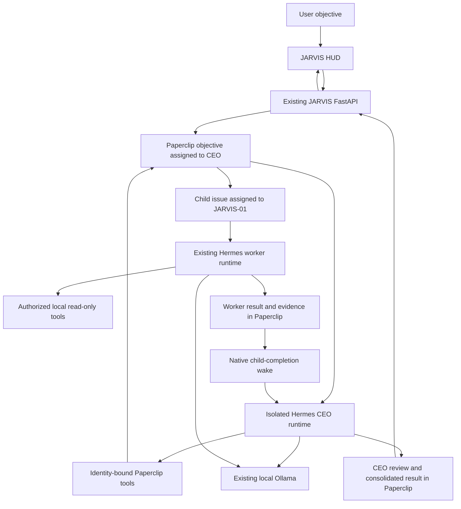

# JARVIS CEO orchestration

Baseline on 2026-11-12 (`a0f7fc7`): **functional browser acceptance passed** for fresh
objectives JAR-14 and JAR-15, including real JAR-16 worker execution, signed
evidence, Paperclip's native CEO wake and the final consolidated report.
The 111-test final-image suite passed, browser refresh and a full five-service
restart preserved the same completed objectives/results, and the roster stayed
at two employees. **CEO functional and restart acceptance are complete.**
Direct chat was observed working through the real HUD with separate sessions
and no new Paperclip work; its full browser helper did not pass because of
recorded harness/model-response limitations. This baseline is archived in
`docs/evidence/ceo-before-tuning.json`.
Historical rejected attempts stay separate. Known model-prose limitations are
recorded below; canonical appended tool data is the verified inventory.

Current follow-up: both existing runtime files select the separately named
`jarvis-hermes-aigoat24:3b` local profile. The current source suite passes 131
tests and the atomic direct-tool/self-scope contract below is deployed.
**Fresh JAR-35/JAR-36 functional browser acceptance passed**, with no child for
the simple objective, real JAR-37 worker execution for the two-role objective,
native CEO continuation, final report, persistent refresh and two employees.
The five-service restart, separate direct-chat regression and explicit AIgoat
restoration also passed. The
historical JAR-14/15/16 results establish the original four-thread baseline;
they are not substituted for the new profile's verification. Measurements,
rejected compatibility cycles and rollback are in
[OLLAMA_TUNING.md](OLLAMA_TUNING.md).

The current evidence is `docs/evidence/ceo-browser.json`, checked at
11:39:15 UTC. Its exact tool-data appendices preserve all nine model names and
byte sizes. Model-generated prose is not independently authoritative: JAR-35
mis-copied one long-tag byte value and JAR-36 shortened that model name; some
metadata/recommendations remain unsupported. These limitations are separate
from the verified tool execution, task graph and exact appended inventory.

| Fresh copied-profile record | Canonical identity | Verified result |
| --- | --- | --- |
| Simple objective | JAR-35 / `44a371b4-603a-4f13-9952-4940ec4e54d1` | Done; actual model-selected direct tool recorded self scope before the read, no child; run `606bf80c-37d6-4de1-8341-5c7d52a79206` |
| Two-role objective | JAR-36 / `0ea710dd-98ac-456f-93ea-41e03be73d7d` | Done; model selected and scoped existing JARVIS-01, delegate run `42e1c990-17dc-4968-a88d-e7e0a68d9cea` |
| Worker child | JAR-37 / `ac83a32e-e476-4648-b615-dbe2cdbe7665` | Done; worker run `d95e85c8-68dc-4e6f-bf4d-2bccb82bf18e` succeeded with scoped HMAC v2/nine models |
| Native CEO consolidation | `d3599b2f-2ec4-4779-ba08-9df1a8fdef33` | Succeeded; `issue_children_completed` / `issue.children_completed`, verified child results delivered for review, substantive final report visible |
| Browser refresh and roster | Same two objectives and two employees | Passed; no unnecessary hire |
| Source tests | Current deployed plugin/source | 131 passed, three existing warnings |
| Five-service restart | `docs/evidence/ceo-tuning-restart.json` | Same JAR-35/36/37 IDs/statuses/comments/runs and complete task-ID set; zero new objectives; actual browser `--resume` passed |
| Separate direct chat | `docs/evidence/direct-chat-regression.json` | Passed actual selected-model turn, visible READY, authentication/WebSocket, task/session isolation and response/DOM scan |
| Existing chat model migration | `docs/evidence/direct-chat-model-migration.json` | Supported endpoint preserved the same session and all 11 projected messages/count/hash; actual next turn verified selected local alias |
| AIgoat restoration | `docs/evidence/aigoat-restored.json` | Explicitly unpaused at 11:47:44.873 UTC; same ID/start time, marker removed, guard stopped |
| Final read-only delivery checks | `docs/evidence/final-delivery-check.json` | All 10 passed; exact service/configuration preservation, original eight models plus new alias, human hiring gate, auth/health and text-secret scan |
| Delivery commit | This delivery commit (see `git log`) | Verified profile, tool contract, documentation and evidence |

## Architecture

The user supplies one objective. Paperclip owns the objective, task hierarchy,
assignments, comments, execution records, approvals and durable progress.
Hermes performs the agent turns and authorized tool calls. Ollama supplies local
inference. JARVIS remains the monitoring and submission interface, using its
existing FastAPI backend.



Paperclip is the only orchestrator and source of task state. The extension adds
no task database, independent task scheduler, message broker or Hermes internal
subagent substitute. A browser polling task history is a view of Paperclip,
not an execution scheduler.

The initial organization contains exactly two operating identities:

| Identity | Responsibility | Runtime |
| --- | --- | --- |
| JARVIS-CEO | Plan, select the minimum team, delegate when needed, review evidence and consolidate the objective | Isolated `hermes-ceo` service / container `jarvis-hermes-ceo` |
| JARVIS-01 | Existing scoped local inspection and read-only execution | Existing `hermes` service / container `jarvis-hermes` |

The verified baseline used `jarvis-hermes:3b`. Both runtimes now select the
separate local `jarvis-hermes-aigoat24:3b` profile for final compatibility
testing, using the same installed weights. The original alias/models and
shared Ollama server configuration remain preserved. PentAGI remains outside
this integration.

## CEO operating policy

The CEO must:

1. Read the real assigned objective, relevant company goals, available employees
   and their actual capabilities through Paperclip.
2. Save a concrete plan and its delegation decision in Paperclip.
3. Reuse an existing suitable employee and select the minimum necessary team.
4. Perform a simple task directly when delegation would add no useful execution
   capacity or independent review.
5. Delegate only clear, bounded responsibilities with a deliverable and acceptance
   criteria. Link every delegated issue to its objective with `parentId`, retain
   the project and propagate the relevant `goalId`.
6. Leave delegated work assigned to the selected worker and keep responsibility
   for the parent objective.
7. Receive completion through Paperclip, then read the worker's actual result and
   execution evidence. A worker's prose or a successful CEO text turn alone is
   insufficient proof of completed work.
8. Consolidate verified results, distinguish retrieved facts from inference, and
   report unresolved errors, missing permissions and blockers.
9. Request another employee only for an essential capability missing from the
   current team. Explain why the existing identities cannot perform the work.
10. Require a human board decision before any new hire becomes active.

The initial implementation must not pre-create a fixed specialist team.
Additional runtimes or agent types come after a verified CEO-to-JARVIS-01
delegation. The local model's ability to generate a plausible plan does not
establish that assignments, execution or review happened.

## Submission and monitoring contract

The deployed HUD extension adds a **CEO objective** mode to the existing typed
input. The existing authenticated `POST /api/tasks` accepts `objective: true`
and resolves the CEO identity from server-side `PAPERCLIP_CEO_AGENT_ID`. The browser does
not choose or supply CEO credentials.

The root issue is created and assigned through Paperclip's documented REST API.
The current CEO ID is `50a7204d-39f5-4e4a-98bb-ff07cf4e526e`; the existing
worker ID remains `09f66b7a-d435-4332-be9a-9223055d0bef` and reports to that CEO.
The existing request nonce/idempotency behavior must protect a retried submission
from creating another objective. Root and child issue IDs, assignees, statuses,
comments and run errors remain Paperclip values.

The HUD must show the objective's plan, real delegated children, execution
progress, worker results and the CEO's consolidated result. A parent awaiting a
worker remains active; it must not appear completed merely because the CEO's
initial planning turn ended.

Phase 5 **Persistent task** mode remains available for direct worker assignments.
**Direct chat** keeps the existing Hermes conversation path and separate session.
It must not create a CEO objective, mutate Paperclip task state or reuse an
issue-scoped execution conversation. Task-history authentication and existing
Origin/WebSocket protections remain required.

## Deployed configuration

The table records current configured identities and boundaries. Native input,
authenticated preflight and the original JAR-14/JAR-15/JAR-16 execution/restart
proof remain the verified baseline. The copied profile and direct-tool
self-scope contract are deployed after 131 passing source tests; fresh
JAR-35 self execution and JAR-36/JAR-37 delegation passed through the actual
HUD. Restart, direct-chat and restoration checks also passed; the evidence
above establishes behavior beyond configuration.


The operator bootstrap is `deploy/bootstrap_ceo.py`; the CEO policy is
`deploy/CEO_POLICY.md`. Bootstrap preserves an existing CEO instead of creating
another, assigns JARVIS-01's reporting line, and enables
`requireBoardApprovalForNewAgents`. It will not disable a pre-existing hiring
gate to create an initial CEO.

The first bootstrap rerun incorrectly included permission fields in the generic
agent PATCH and received HTTP 400. The rerun now updates permissions through the
dedicated `PATCH /api/agents/{id}/permissions` route. A successful rerun retained
the same CEO and worker IDs; no duplicate employee was provisioned.

| Setting | CEO | Existing worker |
| --- | --- | --- |
| Adapter | `hermes_gateway` | `hermes_gateway` |
| Private TLS endpoint | `https://hermes-tls:8644` | `https://hermes-tls:8643` |
| Session strategy | `issue` | `issue` |
| Local model | `jarvis-hermes-aigoat24:3b`, custom provider; JAR-35/36 functional acceptance passed | Same selected alias/provider |
| Ollama API | `http://ollama-models:11434/v1` | Same existing private-network service |
| Context | 65,536 tokens | 65,536 tokens |
| Current copied profile | 24 threads, batch 1,024, output cap 768, temperature 0.1 | Same |
| Preserved baseline / fresh-install source default | `jarvis-hermes:3b`, four threads | Same |
| Execution timeout | 1,800 seconds | 900 seconds |
| Timer heartbeat | Disabled | Disabled |
| Assignment/on-demand wakes | Enabled | Enabled |
| Concurrent runs per runtime | One | One |
| Shared selected-model inference slots | One (`-np 1`), shared with worker | Same shared slot |
| Persistent runtime data | `.runtime/hermes-ceo` | `.runtime/hermes` |
| Runtime template | `deploy/hermes.ceo.config.example.yaml` | `deploy/hermes.config.example.yaml` |

The internal TLS proxy has separate upstreams and matching bounded timeouts.
Neither Hermes container publishes a host port. Both remain attached only to the
internal agent network, without a Docker socket or host workspace mount.

Separate CEO and worker identities/sessions do not imply parallel model
capacity. The current shared model runner uses `-np 1`: one inference request
is served at a time, and another agent/chat request may queue or encounter
the configured Hermes admission limit. Paperclip can retain several tasks
while their model calls wait. Twenty-four CPU threads apply to one eligible
inference call; they are not 24 users or agents. Shared Ollama concurrency has
not been increased, and the performance measurements used serial calls.

The active CEO toolsets are `jarvis_ceo` and `jarvis_readonly`, exposing exactly
three tools:

- `paperclip_context`: authenticated objective, goals, employees and children.
- `paperclip_ceo`: scoped `plan`, `delegate`, `review` and `request_hire`
  actions through Paperclip.
- `local_ollama_models`: real read-only local inventory; the CEO's actual
  selection may atomically record a self-work scope before the read.

For a validated current CEO/company/assigned issue/run with no plan and no
child issues, invoking the inventory tool is the model's explicit choice to
perform that authorized read itself. The handler records a clearly labeled
runtime-generated scope from the real objective and existing tool capability
in Paperclip **before** HTTP, then performs the requested read. A persisted
explicit self plan remains supported. This is symmetric to atomic delegation,
which persists the model-selected assignment scope before creating a child.

The scope is not model-authored rationale and no separate `paperclip_ceo`
planning-tool call is claimed. No prose/keyword routing or hook-initiated tool
execution is involved. A delegate/hire decision or any child issue retains the
error/no-HTTP boundary, preventing the CEO from substituting its own read for
the assigned worker. Missing authorization and failed plan persistence also
stop the read. A denied call explicitly reports an error with no asynchronous
work pending. Worker inventory and user-facing direct chat retain their
existing behavior.

Completion still requires the recorded decision, fresh real tool data or
verified worker evidence, and a substantive model report. The atomic scope
contract is deployed and source-tested. Fresh JAR-35
(`44a371b4-603a-4f13-9952-4940ec4e54d1`) is done: actual HUD checks confirm
canonical status, visible substantive verified inventory, and self selection
without a child. JAR-36 and its real JAR-37 worker also passed the separate
delegation/native-continuation/final-report path; the current two-objective
functional compatibility acceptance is complete. Separate restart, direct-chat
and restoration checks passed as recorded above.

Existing direct-chat sessions can retain a prior model even after runtime
defaults change. The operator migrated the existing direct-chat session using
Hermes's supported `POST /api/sessions/{session_id}/model` endpoint while the
session was idle. A default-selector change alone does not override an
existing session lock. The receipt
verifies the same session and all 11 projected messages (oldest order,
including compacted history), count and SHA-256 before/after; it does not claim
inspection of hidden/rewound raw database columns. The subsequent real HUD turn
used the selected alias/provider, returned HTTP 200 and displayed READY without
creating Paperclip work or altering CEO conversations. The model added prose
before READY; exact one-word compliance is not claimed. The archived
`direct-chat-sticky-model-diagnostic.json` preserves the earlier default/model
mismatch instead of treating it as a failed CEO execution.
[Supported pinned Hermes handler](https://github.com/NousResearch/hermes-agent/blob/v0.23.1/gateway/platforms/api_server.py#L3246)

The worker's active toolset remains `jarvis_readonly` with only
`local_ollama_models`. Terminal, filesystem modification, external web,
Hermes internal delegation and other broad toolsets stay disabled. No fixed
specialist team was added.

## Bounded CEO context with retained audit history

The deployed CEO adapter supplies a small, explicit, nonempty
`payloadTemplate.conversation_history`:

```json
[
  {"role": "user", "content": "Where is authoritative task context?"},
  {"role": "assistant", "content": "Paperclip. I will use the current authenticated objective and verified results supplied for this turn."}
]
```

This is a stable context anchor, not a substituted objective or a claimed prior
execution. The deployed adapter retains this anchor and **clears the static
`payloadTemplate.input` override**. Bootstrap sends `input: null` so an earlier
nested configuration value cannot remain active through a merge. The CEO policy
remains separate.

Paperclip's native `buildInput` then supplies the actual objective/run identity,
current wake reason, task context and child-completion summaries. The previous
ordinary-execution override replaced that real wake input with a generic
conditional bootstrap prompt. That abstraction lost the direct signal that
worker results were already complete. Restoring native input is a configuration
change through the supported adapter, not a Paperclip core patch.
Installed source:
`packages/adapters/hermes/src/gateway/server/execute.ts`, `buildInput` near
line 335 and `buildRunBody` near line 393.

Pinned Hermes v0.23.1 treats a **nonempty** supplied history as authoritative for
that turn, even with an explicit `session_id`. An empty `[]` would fall back to
the accumulated session transcript, so it is not equivalent.
[Official conversation semantics](https://hermes-agent.nousresearch.com/docs/user-guide/features/api-server#conversation-and-terminal-result-semantics).

The issue-scoped `session_id` and session-key strategy remain unchanged. Earlier
Hermes transcript rows, failed attempts, logs and Paperclip task/comment/run
history are retained. This changes what the model replays, not the durable
audit history. Newly generated messages still append to the same session.

Pinned implementation and upstream contract references:

- [Runs history resolution and precedence](https://github.com/NousResearch/hermes-agent/blob/v0.23.1/gateway/platforms/api_server_runs.py#L493):
  supplied nonempty history bypasses SessionDB history loading.
- [Canonical admission history](https://github.com/NousResearch/hermes-agent/blob/v0.23.1/gateway/session_api_turn.py#L167):
  the admitted run retains the caller's explicit history.
- [Execution history selection](https://github.com/NousResearch/hermes-agent/blob/v0.23.1/gateway/run_turn_runner.py#L852):
  explicit API history takes precedence over accumulated/cached conversation
  history.
- [Append-only transcript persistence](https://github.com/NousResearch/hermes-agent/blob/v0.23.1/agent/session_persistence.py#L308):
  caller-seeded prefix rows are skipped as already durable and new turn rows
  append; this path does not delete the old transcript.
- [Upstream explicit-history contract test](https://github.com/NousResearch/hermes-agent/blob/v0.23.1/tests/gateway/test_api_cutover_results.py#L8):
  asserts that explicit history survives admission with the same session ID.
  This source test was inspected; no upstream Hermes core test run is claimed.

Explicit history disables Hermes's transcript-delivery wake authority for those
turns. That is separate from this integration's Paperclip child-completion wake,
which dispatches another authenticated API run. Hermes internal subagent or
background transcript-delivery delegation is not used.

The context tool reconstructs a bounded view of operator updates and structured
plan/review/wait markers from Paperclip, excluding old unverified CEO report
prose. Those updates support the next decision; current task state and verified
execution evidence remain authoritative. The hook independently restores the
trusted plan decision from Paperclip comments.

This CEO-only setting leaves the worker and user-facing direct-chat history
behavior intact. It uses the existing local model and changes no Ollama
configuration. The nearby Hermes `history_tool_output_max_chars` setting caps
stored `/v1/responses` history and does not provide this `/v1/runs` behavior.
The smaller replay reduces stale failed context in the final accepted
execution. Clean-context execution passed on fresh objectives; no controlled
latency improvement or CPU benchmark is claimed.

## Authenticated preflight and model review

The deployed plugin uses Hermes's supported
`pre_llm_call` return contract:

```python
return {"context": "Authenticated current objective and verified result facts"}
```

Hermes appends a nonempty string or `{"context": ...}` return to the current
turn's user message, once before the model/tool loop. It does not replace the
system prompt or require editing history. A valid
`{"action": "block", "message": ...}` return can stop the turn before inference.
Other invented `messages` or `prompt` return fields are not a supported rewrite
mechanism.
[Official hook contract](https://hermes-agent.nousresearch.com/docs/user-guide/features/hooks#pre_llm_call);
[pinned plugin documentation](https://github.com/NousResearch/hermes-agent/blob/v0.23.1/website/docs/developer-guide/plugins/index.md#pre_llm_call-context-injection);
[pinned context collector](https://github.com/NousResearch/hermes-agent/blob/v0.23.1/agent/turn_context.py#L906).

The lifecycle `begin` hook authenticates the runtime identity and company,
checks the assigned issue and owning run, and performs checkout using the
current `X-Paperclip-Run-Id`. It then calls `prepare_turn_context` and returns
`{"context": text}` through Hermes's supported hook.

The context contains the actual objective, goals, employee/child states and
bounded operator/control-plane updates. When every child is done, the helper
verifies worker authorship, version 2 HMAC, exact company/agent/issue scope and
the latest matching succeeded worker run **before** exposing results as ready.
It delivers those verified names and sizes to the current model turn rather
than requiring the model to discover a second mandatory read tool. These are
real read/verification operations against Paperclip, not fabricated tool output.

The callback uses a **20-second monotonic budget**, shared across identity and
assignment reads, checkout, context assembly, result verification and settlement
checks. The request wrapper checks remaining time before/after API calls and
sets each HTTP timeout to the smaller of eight seconds and the remaining
budget. Budget checks also bound result-settlement waits. A failed preflight
clears delivery evidence and returns a block directive rather than a ready
result. The default Hermes callback timeout is 30 seconds; the integration
does not rely on an abandoned callback eventually finishing. Final validation
must retain coverage of timeout/failure behavior, not infer it from the happy
path alone.

Lifecycle work is audited in
`.runtime/hermes-ceo/logs/ceo-preflight.jsonl` with source
`hermes_pre_llm_call`, the current issue/run/session, delivery action and a
context hash. This is separate from `ceo-tools.jsonl` and actual model tool-call
audits. A `[JARVIS CEO RESULTS READY]` comment means verified worker data was
supplied **for CEO review**; it explicitly says that delivery is not approval of
the model's analysis. No model review, thought process or tool invocation is
invented by the lifecycle audit.

The CEO model still chooses whether to delegate, selects the employee and scope,
and writes the final analysis. The preflight creates no tasks, assigns no
employees, schedules no jobs and does not synthesize the final report. An
additional explicit review-tool call may refresh results, but it is not a
mandatory extra turn when the same verified facts have already been delivered.

Child-completion finalization requires either explicit review or delivery of
the exact child set into the **current** CEO run with a recorded context hash.
It rechecks canonical proofs/runs, and requires a substantive model report
identifying retrieved facts. A waiting-only response, merely supplied data or a
successful assistant turn remains insufficient. These checks are implemented and the fresh delegated report/finalization
passed browser acceptance before and after the service restart. Direct-chat
behavior and the remaining full-helper limitation are recorded below.

The operator work instruction is intentionally short: collect only exact model
names, `size_bytes` and `size_gib`, in one compact table within 200 words.
Do not request vocabulary statistics, full metadata dumps or another long report.
The CEO owns the consolidated technical analysis. This changes scoped instruction
wording, not the worker's authorized tools or local model configuration.

## Authentication and identity isolation

There are two distinct credential directions:

| Direction | Credential | Storage and boundary |
| --- | --- | --- |
| Paperclip to Hermes gateway | That Hermes service's `API_SERVER_KEY` | Paperclip secret management; configured through an adapter `secret_ref` |
| Hermes tool/hook to Paperclip | The executing Paperclip agent's API key | Server-side environment in that identity's isolated runtime |
| Browser to JARVIS | Existing HUD authentication | Existing authenticated HUD flow; no Paperclip or Hermes API key exposed |

The CEO and worker use separate Paperclip agent keys and separate runtime
configuration. The private deployment values are `HERMES_PAPERCLIP_CEO_KEY`
and `HERMES_PAPERCLIP_AGENT_KEY`; Compose supplies the correct value as
`HERMES_PAPERCLIP_AGENT_KEY` inside each respective runtime.
The separate CEO gateway key is configured as `API_SERVER_CEO_KEY` in the
deployment environment and mapped to its internal `API_SERVER_KEY`. The CEO runtime must never use the worker's callback key, and
neither agent runtime receives JARVIS's board key. Agent keys are company-scoped
bearer credentials, returned once on creation and hashed by Paperclip.
[Official authentication reference](https://docs.paperclip.ing/reference/api/authentication/).

Narrow supported Hermes plugin tools expose CEO context, plan recording,
delegation, result review and hire requests. They do not expose a general HTTP
client, arbitrary bearer-token selection, shell access, arbitrary URLs or host
filesystem access. Tools derive the executing identity, company, root issue and
active run from trusted runtime context and authenticated Paperclip reads.
Model-supplied arguments cannot select another identity or override credentials.

Before acting, a tool/hook must verify that the runtime's Paperclip identity and
company match the session scope, the current issue is assigned to that identity,
and the active Paperclip run owns the execution. Mutating calls carry
`X-Paperclip-Run-Id` for audit attribution. Child assignment is limited to valid,
ready employees in the same company and the authorized delegation scope.

Keep `sessionKeyStrategy: issue` for both gateway adapters. A CEO objective and a
worker child have different Paperclip issue IDs and different identities, so
they must retain separate Hermes sessions. Never put API keys in prompts,
comments, plan documents, result text, evidence JSON or logs.

The existing private transport protections remain required. The CEO gateway must
have authenticated, appropriately trusted private transport; exposing a new
unauthenticated service port is not part of this design.

## Gateway callback issue #9956

[Paperclip issue #9956](https://github.com/paperclipai/paperclip/issues/9956)
describes successful gateway dispatch followed by unauthenticated remote-agent
callbacks. The installed source was inspected rather than assuming that a
successful Hermes request also authenticates callbacks.

In the inspected Paperclip release 2026.1106.0:

- `packages/adapters/hermes/src/gateway/index.ts` declares
  `supportsLocalAgentJwt: false`.
- `packages/adapters/hermes/src/gateway/server/execute.ts` builds the run body
  without forwarding `ctx.authToken`.
- `paperclipApiUrl` supplies a reachable API URL; it is not callback credentials.
- Adapter `apiKey` authenticates Paperclip to Hermes and is the Hermes
  `API_SERVER_KEY`, not a Paperclip agent key.

The documented gateway fields and credential distinction are in the
[official Hermes gateway reference](https://docs.paperclip.ing/reference/adapters/hermes-gateway/).

This extension therefore provisions a separate server-side Paperclip agent
credential for each isolated runtime through the supported agent-key API. It
does not patch Paperclip, mint replacement JWTs, disable authorization, reuse a
board key or embed credentials in instructions.

Diagnose callback failures by direction and identity:

- **401**: check whether the callback actually carries the correct Paperclip
  bearer credential. A working gateway key proves only the opposite direction.
- **403**: verify the authenticated agent, company, assignment, active run,
  task scope, membership and the permission required by the attempted action.
  Do not turn a valid authorization denial into a blind retry.
- **409** during checkout: another execution owns the task; stop rather than
  retrying ownership acquisition.

Live identity, company-goal, assigned-task and hiring-permission calls passed.
Fresh worker execution, native CEO preflight and final report/completion
callbacks also succeeded. The five-service restart preserved these records;
live direct chat was observed with the separate-session/task-isolation checks
passed on its first attempt, subject to the helper limitations below.

## Worker execution evidence

The worker lifecycle hook appends a version 2
`JARVIS_EXECUTION_EVIDENCE` record to its Paperclip result comment after a
successful inventory call. The record contains the worker identity, Paperclip
run ID, exact issue session, tool name and retrieved model values. It is signed
using HMAC-SHA256 over canonical JSON.

`JARVIS_EXECUTION_PROOF_KEY` is generated server-side and supplied only to the
trusted worker/CEO plugin environments. It is never exposed through a tool,
prompt, model result or browser response. The signature and verified inventory
may be stored in Paperclip; the signing secret may not.

The evidence boundary requires all of these conditions, including the implemented
preflight delivery path:

- The child is done and its result comment is authored by its assigned worker.
- The proof is version 2 and its MAC validates.
- The complete session scope matches the current company, assigned worker and
  exact child issue; a proof from another company, agent or issue is rejected.
- The proof identifies `local_ollama_models` and contains real retrieved data.
- The latest execution **by the child's assigned worker** is the proof's exact
  Paperclip run and has succeeded. A child `/runs` response can also include the
  delegating CEO's run; that is not a worker execution. An older succeeded
  worker attempt cannot excuse a newer failed or unfinished worker execution.
- Version 2 binds the issue through its complete
  `paperclip:company:...:agent:...:issue:...` session. An extra `issue_id` field
  is not required; full session scope, assigned author, valid MAC and matching
  worker run are required.

The review tool performs only a bounded check while the just-finished adapter
run settles; it does not install an idle polling scheduler. The CEO lifecycle
hook requires a recorded plan and actual direct-tool evidence, or verified child
data delivered by the preflight/explicit review, with the same final evidence
recheck. A planning response, invented evidence
string, forged MAC, different author/scope or stale successful run is
insufficient. The source suite covers these rejection boundaries. The fresh
worker proof, native delivery and CEO report pass on real execution and retain
their exact state, comments and runs after restart. Direct chat has the
separately documented browser-helper limitation.

## Persistent delegation and native continuation

The installed Paperclip implementation already provides the continuation needed
for a CEO that delegates to an employee:

1. CEO checks out the assigned root issue.
2. CEO chooses a valid existing employee from authenticated context and supplies
   a title, scoped responsibility and acceptance criteria with its
   `paperclip_ceo` delegation action. Those model-selected fields constitute
   the delegation plan. An optional `plan` argument can add minimum-team
   reasoning. The tool persists that plan in Paperclip **before** creating its
   assigned child through `POST /api/companies/{companyId}/issues`, with explicit
   `parentId`. This combines the model-facing action, not a new orchestrator or
   an all-or-nothing database transaction. Employee selection remains with the
   model; no automatic selection or fixed team is introduced.
3. CEO leaves the parent assigned to itself but marks it `blocked` with a
   self-owned `unblockDescriptor` identifying its concrete action: review the
   delegated child results when Paperclip delivers their completion wake.
   It records `[JARVIS CEO WAITING]` and the pending child work. No
   `blockedByIssueIds` edges are added; native child completion is the selected
   continuation path.
4. The initial CEO Hermes turn exits. Its lifecycle hook must **not** mark the
   parent done while children or required evidence remain unresolved.
5. Paperclip wakes JARVIS-01 on assignment. The worker checks out its own child,
   executes real tools and stores its result on that child.
6. Worker updates its child to `done` only after successful execution and
   required evidence verification.
7. When every direct child is terminal, Paperclip wakes the CEO with
   `issue_children_completed`.
8. The existing checkout path accepts the blocked parent and moves it back
   into active execution. Authenticated preflight verifies and delivers the
   completed worker facts for CEO review. The model
   produces its own consolidated analysis, and finalization rechecks the evidence
   and report quality before completing the parent.

Installed-source references:

- `server/src/services/issues.ts`,
  `getWakeableParentAfterChildCompletion` near line 9287.
- `server/src/routes/issues.ts`, child terminal-transition handling near
  line 15828, with a corresponding issue-comment transition path near 19226.
- `skills/paperclip/SKILL.md`, task delegation and automatic wake guidance.

The native parent wake requires an assigned ordinary execution issue. It excludes
conversation tasks, `backlog`, `cancelled` and an ordinary parent already marked
`done`. It accepts the chosen `blocked` parent. Every direct child must be
`done` or `cancelled`; the wake includes child IDs and summaries from the latest
child comments. A cancelled child is terminal for wake purposes but does
**not** prove the objective succeeded. CEO review preserves that distinction.

Workers should deliver on their own child issues. Requiring a worker to write
its final answer on the parent can cause a legitimate scope denial. The CEO can
read the child and its evidence after the native wake.

The blocked wait is deliberate. Installed Paperclip's successful-run handoff
recovery does not treat a bare `parentId` child plus a waiting comment as a
durable disposition for an `in_progress` parent. It checks the parent's own
execution/wakes, explicit blocker edges, pending interactions/approvals and
monitors. A worker's separate child execution does not count as the parent's
active execution path. Leaving only `in_progress` risks an unnecessary
`finish_successful_run_handoff` CEO turn before the child completes.

The chosen self-owned blocked status avoids that lane: successful-run handoff
accepts blocked as a valid disposition, stranded recovery scans
`todo/in_progress/in_review`, and the dependency backstop ignores tasks with
no blocker edges. Native child completion still accepts blocked parents.
Relevant installed sources are
`server/src/services/recovery/successful-run-handoff.ts` near line 499,
`server/src/services/heartbeat/run-lifecycle.ts` near lines 1630-1871,
`server/src/services/recovery/service.ts` near lines 4480 and 5850, and
`server/src/services/issues.ts` near line 9287. The actual self-owned blocked
wait and native CEO wake passed in the fresh JAR-15/JAR-16 graph.

Paperclip also supports `blockedByIssueIds` with
`issue_blockers_resolved` wakes when all blockers are done. The selected minimal
path uses native child-completion continuation; adding both paths requires
verifying duplicate-wake handling. No service should poll an otherwise idle
company indefinitely to discover completion.
[Official delegation guide](https://docs.paperclip.ing/guides/org/delegation/).

## Hiring governance

The company must retain `requireBoardApprovalForNewAgents: true`.
The CEO may request a hire through
`POST /api/companies/{companyId}/agent-hires` only when a recorded plan identifies
an essential missing capability. The request includes the proposed role,
capabilities, reporting line, safe runtime configuration and source issue.

With approval required, the API creates an inert `pending_approval` draft and a
linked `hire_agent` approval. The draft is not an active employee; no work should
be assigned to it before human approval and runtime provisioning. Board
approve/reject/request-revision routes are not exposed as CEO tools.
[Official hiring approval guide](https://docs.paperclip.ing/how-to/handle-board-approvals-for-hires/)
and [approvals API](https://docs.paperclip.ing/reference/api/approvals/).

Set explicit CEO `permissions.canCreateAgents` and verify the effective
permissions through real authenticated calls. There is an inspected-source
discrepancy to retain in the operating record: the bundled create-agent skill
says the CEO title alone does not confer hiring permission, while
`server/src/services/authorization.ts` has a legacy `role === "ceo"` authority
path. Company approval enforcement must hold regardless of that legacy path.
Do not rely only on a displayed role label as permission evidence.

A safe permission probe can test the hire route without adding a draft or
approval. Send a syntactically valid request with `adapterType: hermes_gateway`
and `inheritRuntimeFrom: caller`. In this installed release, authorization runs
before the handler rejects that combination with HTTP 422:
`inheritRuntimeFrom=caller requires adapterType=paperclip_runner`.
This rejection occurs before insertion. A schema-validation HTTP 400 alone
does not establish that hiring permission was evaluated.

Any changed version must have this ordering rechecked before using that probe.
The probe is a test helper, not a runtime hire path. The live probe passed:
CEO 422 at the known post-authorization guard, worker 403 and anonymous 401.

The first board-approval-denial test incorrectly expected 403 for a nonexistent
approval. It received 404 because `router.param("id")` invokes
`canActorReadApproval` before the handler's board-only guard. That failed
expectation was corrected; a missing-resource 404 is explicitly **not**
authorization-denial evidence.

The initial corrected live test used a real board-created
`request_board_approval` fixture with no requesting agent and no linked issues:
`48f21851-b6cd-4358-8629-4c96d45f3293`. CEO read returned 200, its attempted
approval returned 403, and the fixture stayed pending. Board cleanup then
rejected it. That initial zero-to-one approval-count result is preserved in
`docs/evidence/ceo-permissions-initial.json`.

The final permission rerun at 09:06 UTC passed and reused the same already
rejected neutral fixture. Employee count stayed two-to-two and approval count
one-to-one; no additional record was created. The fixture remained rejected.
This neutral type invokes no hire lifecycle; its null agent and empty issue
links avoid a CEO wake. Final evidence is
`docs/evidence/ceo-permissions.json`.

## Rejected live attempts and verified fixes

The first live attempts are preserved, not counted as successful acceptance.

**JAR-10 report quality.** The CEO really called the local inventory tool, but
its final prose only said it was waiting for confirmation/child completion.
The original snapshot had a succeeded runtime and an issue marked done; the
acceptance review rejected it as an incomplete technical report. Retrieved data
appended to a waiting message did not satisfy the requested report. The same
canonical objective was reopened for a genuine retry. Evidence:
`docs/evidence/ceo-first-report-rejected.json`.

The stricter completion guard removes leading Markdown/whitespace before
checking waiting/pending prefixes. It rejects waiting-only prose when no child
execution is pending, and requires actual retrieved model names in report
prose. It also retains the plan/tool/worker-evidence checks. These are acceptance
conditions, not replacements for a real local model turn or generated report.

**JAR-10 stale retry context.** A subsequent retry replayed the failed earlier
conversation, produced no fresh local inventory tool call and was correctly
blocked by the updated source guard. It is retained in
`docs/evidence/ceo-retry-rejected-jar-10.json`, not counted as a successful
report. This prompted the supported explicit-history configuration above.
Prior reports are kept for audit while the next turn reconstructs real current
context through the identity-bound Paperclip tool. Fresh clean-context
acceptance subsequently passed on JAR-14 and JAR-15, as recorded below.

**JAR-11 delegation contract.** The initial model turn attempted delegation
before a durable plan existed. The tool refused that action, and no child task
was created. The model subsequently called inventory itself; neither that call
nor its successful text-generation exit proves CEO-to-worker delegation.
Evidence: `docs/evidence/ceo-initial-delegation-rejected.json` and
`docs/evidence/ceo-initial-browser-stage.json`.

The current delegation action accepts the model-selected valid employee,
title, scoped responsibility and acceptance criteria as the plan itself.
It persists these fields before the child issue POST. An optional `plan`
argument adds rationale but is no longer required for an otherwise complete
scoped delegation. This removes the brittle separate-argument requirement while
preserving the model's team and responsibility decision. No deterministic
replacement orchestrator was added.

**JAR-10 accepted fresh report.** The later clean-context self-execution
passed the browser acceptance checks. CEO run
`37f85807-d4b4-4102-a3b9-551c4183258d` succeeded, recorded a real
`local_ollama_models` call containing eight installed models, and produced a
substantive report rather than a waiting message. The HUD displayed exact model
names/byte sizes and the same canonical Paperclip task/status. Evidence:
`docs/evidence/ceo-browser.json` and `docs/evidence/ceo-jar-10.png`.
Earlier rejected runs remain part of JAR-10 history; only this accepted fresh
execution establishes the direct CEO report result.

**JAR-11 superseded after a legacy execution stop.** Its operator-cancelled
legacy execution entered Paperclip's quarantine with continuation/retry
unavailable. A supported native retry request was accepted/deferred at the API
level without establishing a new runnable execution. An accepted receipt was
not counted as a new Hermes turn. The integration did not edit Paperclip
internals or bypass the execution guard. The old objective was marked cancelled
and superseded; its history is retained in
`docs/evidence/ceo-cancelled-attempt.json`,
`docs/evidence/ceo-task-retry-receipt.json` and
`docs/evidence/ceo-delegation-retry-receipt.json`.

**JAR-12 scoped delegation retry.** A fresh two-role objective was submitted
through the actual HUD:
`f8f4222d-6a0b-4b08-ad5c-5beec6abf0e0`. Its first model turn supplied an
employee, title and scope but omitted the legacy optional rationale argument.
The strict tool rejected the attempt and created no child; the run ended in a
logical blocked disposition without an operator cancellation or the JAR-11
legacy stop blocker. Unrelated inventory prose was not accepted as delegation.
Evidence: `docs/evidence/ceo-delegation-contract-rejected.json`.

The same JAR-12 then used the corrected scoped-fields-as-plan contract and CEO
direct-inventory gate. It created JAR-13, which completed real worker tools and
signed evidence. That partial graph succeeded, but the following CEO report
still failed, as recorded below. It is not counted as complete acceptance.

**JAR-12 native result-delivery failure.** Worker JAR-13
(`b58af7b0-e4d1-4343-bc05-15e12defcdbc`) reached done with valid HMAC evidence.
Paperclip itself dispatched CEO run
`e9941f2a-c56a-4ccf-a850-26e54f478e79` on child completion. The CEO nevertheless
skipped completed-result review and produced another waiting-only answer while
receiving the generic bootstrap input. The parent correctly remained blocked;
no consolidated result was accepted. Evidence:
`docs/evidence/ceo-native-review-rejected.json`.

JAR-12 has since been cancelled, while the completed JAR-13 data and all run
records remain retained. The final fix restores native wake input and delivers
authenticated completed-child facts through the supported preflight. Model
analysis and the complete workflow were subsequently proven on fresh JAR-14
and JAR-15; the old JAR-10 pass was not combined with this rejected graph.

**Blocked callback authorization.** The initial JAR-11 finalization tried to
PATCH blocked with `unblockDescriptor.owner: "board"`. Paperclip
`server/src/routes/issues.ts` near line 14144 explicitly denies an agent naming
board, user or another agent as its unblock owner. The result was HTTP 403.

This was not a missing gateway callback credential or missing run header:
checkout returned 200 at 06:58:14.214 UTC and the failed PATCH at 07:04:36.941 UTC
carried the same original run ID,
`c47b8c5b-74c5-4384-9c33-d91fc5e61a33`. The assistant runtime subsequently
reported success, while its reporting hook had failed; that run is not accepted
as completed objective work. Recovery was halted for the integration fixes.

CEO and worker blocked-status callbacks now name only their own executing
identity:

```json
{
  "unblockDescriptor": {
    "owner": {"agentId": "CURRENT_EXECUTING_AGENT_ID"},
    "action": "Review the concrete execution blocker and explicitly retry."
  }
}
```

The corrected authorization probe returned 200 using the original CEO run
header. It is explicitly an API permission test, **not a new model execution**:
`docs/evidence/ceo-blocked-callback-fix.json`. A separate probe without that
header received the expected 403
`cross_issue_influence_run_context_required`; that probe does not explain the
original callback failure, whose header was valid.

An actual pending hiring approval now places the CEO objective in
`in_review`, linked to the human approval path. Other blocked descriptors are
self-owned. The agent cannot invent board ownership or bypass a human decision.

An earlier source suite reported **79 passing tests** for the delegation,
completion-quality and blocked-owner fixes. The subsequent scoped-delegation
and CEO inventory-gate expansion reached the final **111-test** suite described
below. JAR-12 remains a rejected historical graph; fresh JAR-15/JAR-16 supplies
the accepted worker execution, native continuation and visible consolidation.

**Fresh final-cycle JAR-14 report.** The final configuration executed
`4ced33fc-58d1-4053-8303-02963c645763` through CEO run
`b0dc4e22-b6e3-4258-aef7-e1bd0e669bb3`. The CEO recorded a self plan, made a
real local inventory call and produced a substantive report. Browser evidence
confirms the canonical task/status and visible exact appended inventory.
This fresh direct-report check passed; it is not the historical JAR-10 pass.
Evidence: `docs/evidence/ceo-browser.json` and `docs/evidence/ceo-jar-14.png`.

The generated prose is **not** byte-exact transcription. It labels a column
“Size (Bytes)” while writing rounded GB/MB strings, misspells
`ministral-3:3b` as `minutral-3:3b`, and shortens another model label.
Its claim that every prose size is exact must not be treated as verified.
The separately appended canonical tool data retains the exact full names,
integer `size_bytes` and supplied `size_gib`; those values are the authoritative
inventory. The functional check proves real execution and available verified
data, not perfect local-model wording or capability recommendations.

**Fresh final-cycle JAR-15/JAR-16.** The two-role objective is
`00b34673-2995-460d-af5e-7622e5ee1b6d`, with initial CEO run
`3498ac8f-43b6-4506-9b43-f1c55d3afd26`. The CEO selected the existing
JARVIS-01 worker and created its scoped child JAR-16,
`b76a924a-d1ed-4f06-9b84-68709bf8ad4f`. Worker run
`6c959144-3a31-43a8-a785-fd110477ba78` succeeded at approximately 09:01 UTC,
and its version 2 signed proof contains eight real installed models.

Paperclip itself dispatched CEO continuation
`0d3512f0-266b-437f-ab95-61ae2fb869f1`, with canonical
`wakeReason: issue_children_completed` and
`source: issue.children_completed`. No manual worker or completion wake was
used. The fresh lifecycle audit records `verified_child_results_delivered`
for this exact objective, CEO run and child, and its `RESULTS READY` comment
records delivery **for review**. This is actual worker execution, native
continuation and verified result delivery, not merely narrated delegation.

The CEO continuation succeeded at 09:19:56 UTC, stored its substantive
consolidated report and completed JAR-15. Its table contains all eight exact
model names, integer byte sizes and supplied GiB values. The actual Chromium
acceptance helper finished with `--resume` and exit code zero; both fresh
objectives and their results were visible, matched canonical Paperclip state,
and survived browser refresh with unchanged comment hashes. No additional
employee was created.

The compact final-cycle proof is
`docs/evidence/ceo-native-wake-final.json`, and browser acceptance is
`docs/evidence/ceo-browser.json`. The fresh preflight record remains in
`.runtime/hermes-ceo/logs/ceo-preflight.jsonl`.
`docs/evidence/ceo-native-wake.json` belongs to the older rejected JAR-12 attempt
and is retained as historical evidence, not substituted for this fresh wake.

The report's additional source claims are not all established by the proof.
The actual source is Ollama's private `/api/tags` inventory endpoint, with
Paperclip/Hermes control-plane authentication and a plugin-signed execution
record. No binary file manifest or on-disk model file inspection occurred.
Statements about “source files,” authenticated Ollama access or exact binary
manifest alignment are model-generated overclaims, not extra verified work.

## Verified functional and restart acceptance

The full regression suite passed **111 tests** in final HUD/helper image
`sha256:4563c682e276668ce29d894c71622bff800b329dfe132e1328fea122117cda56`
before the final live acceptance run. This supersedes the earlier 79-test
result and intermediate 93-test estimate. The successful browser run independently
verifies execution and visible results. A further real `--resume` run exited
zero after the five-service restart; the same objectives, result hashes and
runs persisted without creating another objective. Direct-chat observations
and the incomplete full-helper check are recorded separately.

Permission evidence is in `docs/evidence/ceo-permissions.json`; isolation
evidence is in `docs/evidence/ceo-isolation.json`.

Observed permission results:

| Check | Result |
| --- | --- |
| CEO and worker `/agents/me` | 200 with distinct configured identities |
| Both identities read company goals and their assigned-task lists | 200 |
| CEO `canCreateAgents` | true |
| Worker `canCreateAgents` | false |
| Human hire approval required | true |
| Safe hire-route authorization probe | CEO 422, worker 403, anonymous 401 |
| Missing approval UUID | 404; not counted as permission denial |
| CEO reads the actual neutral fixture | 200 |
| CEO attempts to approve the readable neutral fixture | 403, fixture unchanged; rejected fixture reused in final rerun |
| Neutral fixture lifecycle | Initial board rejection 200; final rerun reused the already rejected record |
| Final employee count before/after | Two to two, identical IDs |
| Final approval count before/after | One to one; same rejected neutral fixture, no additional approval |

Isolation inspection verified that each Hermes runtime carries its correct
separate callback identity, neither contains the Paperclip board key, neither
mounts the Docker socket, and neither publishes a host port. Both remain on the
internal agent network with proof signing configured. The installed Ollama
inventory names and exact byte sizes match the Phase 5 baseline.

These boundary checks establish configuration, permissions and isolation.
Historical JAR-10 and rejected JAR-12/JAR-13 results remain separate.
Fresh JAR-14 direct execution and the complete JAR-15/JAR-16 delegation,
worker execution, native result delivery and CEO report pass under the final
configuration. Functional and service-restart acceptance are verified. The
remaining full direct-chat helper limitation does not represent a failed CEO
execution or a claimed complete regression-suite pass.

The following table records the original four-thread `a0f7fc7` baseline,
not the copied-profile acceptance above.

| Baseline acceptance record | Canonical issue | Status |
| --- | --- | --- |
| Historical self-execution | JAR-10 / `688cb31a-9c24-4fa9-a068-9b07abe4bb61` | Earlier pass retained separately; not the final-cycle direct report |
| Superseded initial delegation | JAR-11 / `3c19ceb9-dd44-47a8-852c-9f1cc650fa18` | Cancelled/superseded after legacy execution quarantine; not accepted |
| Rejected consolidation graph | JAR-12 / `f8f4222d-6a0b-4b08-ad5c-5beec6abf0e0`, child JAR-13 | Worker done/native CEO wake verified; consolidation rejected, parent cancelled |
| Final simple inventory objective | JAR-14 / `4ced33fc-58d1-4053-8303-02963c645763` | Passed self-plan, real tool and substantive report on run `b0dc4e22-b6e3-4258-aef7-e1bd0e669bb3`; exact appendix distinguished from flawed prose |
| Final two-role objective | JAR-15 / `00b34673-2995-460d-af5e-7622e5ee1b6d` | Done; actual worker delegation, native continuation and final report passed |
| Final worker child | JAR-16 / `b76a924a-d1ed-4f06-9b84-68709bf8ad4f` | Done; worker run `6c959144-3a31-43a8-a785-fd110477ba78` succeeded with valid v2 proof/eight models |
| Final native child-completion wake | CEO continuation `0d3512f0-266b-437f-ab95-61ae2fb869f1` | Succeeded; verified `issue_children_completed` / `issue.children_completed`, no manual completion wake |
| Fresh authenticated result delivery | Same JAR-15/CEO run and exact JAR-16 child | `verified_child_results_delivered` and RESULTS READY for review recorded |
| Final substantive delegated CEO report | JAR-15 / same native CEO continuation | Passed; all eight model names and exact sizes in the final table, with source-claim limits noted above |
| Final plugin/image regression suite | Final image ID recorded above | 111 passed before current acceptance run |
| Browser refresh and two-agent roster | Archived `docs/evidence/ceo-before-tuning.json` | Passed; unchanged result hashes, no browser errors and no unnecessary employees |
| Service restart | `docs/evidence/ceo-restart.json`, `docs/evidence/ceo-delivery.json` | Passed at 09:33 UTC; same JAR-14/15/16 statuses, comment hashes and runs, zero new objectives; browser `--resume` exit 0 after restart |
| Legacy Phase 5 persistence | `tests/live_persistence.py` | Passed against existing baseline records after restart |
| Live direct-chat regression | `docs/evidence/direct-chat-regression.json` | Observed working with first-attempt UI/session/task-isolation assertions passed; complete helper pass is not claimed |
| Baseline delivery commit | `a0f7fc7` | Verified original implementation, docs and evidence |

Both fresh objectives were submitted through the actual HUD under the final
configuration. JAR-16 now supplies real worker execution, signed data and a
native CEO result-delivery path. Both final reports and restart persistence
are verified. Historical accepted runs are not substituted for these fresh
objectives. The real direct-chat observations and its harness limits remain
explicit below.

The first objective is exactly:

> Inspect the local Ollama installation, identify installed models, and produce
> a technical inventory report.

The second objective explicitly requires the existing JARVIS-01 technical
operator to retrieve actual model names/sizes, followed by independent CEO
review of the worker's succeeded execution and signed evidence, then report
consolidation. It forbids hiring. The worker owns collection; the CEO owns
review. A narrated team plan without persistent child assignment and real
execution does not pass.

The browser test records progress in `.runtime/ceo-browser-stage.json` and
writes successful proofs to `docs/evidence/ceo-browser.json`. These are test
artifacts, not another product task store. Paperclip remains authoritative.
Keep failed attempts and fixes in this delivery record even after a successful
retry.

The local model's recommendations remain model-generated. Exact retrieved
inventory values and actual execution records must be distinguished from
capability guesses or unsupported claims. No cloud LLM fallback is authorized.

## Acceptance-harness contract corrections

The final browser helper passed after correcting its API-shape assumptions,
not by relaxing execution/evidence requirements:

- Native completion context uses `childIssueIds` plus a child-summary **array**,
  not a guaranteed singular child field.
- Signed proof version 2 binds the issue in the complete session scope; the
  helper no longer demands a nonexistent separate `issue_id` field.
- Child run history can include the creator/delegating CEO run. The latest-run
  check selects only executions by the actual assigned worker before matching
  the signed proof and requiring succeeded status.

These corrections preserve exact scope, authorship, HMAC and actual-execution
checks. Paperclip's API and orchestrator internals were not changed. The accepted
final-cycle native wake is independently recorded in
`docs/evidence/ceo-native-wake-final.json`; historical rejected execution and
earlier harness failures remain separate.

## Direct-chat regression and operating limits

All five JARVIS services were restarted and running at 09:33 UTC: HUD, worker
Hermes, CEO Hermes, TLS proxy and Paperclip. The services with health checks
reported healthy. `docs/evidence/ceo-restart.json` records identical JAR-14/15/16
statuses, comment SHA-256 hashes, parent relationships and execution runs before
and after restart, with zero new objectives. The actual browser `--resume`
exited zero afterward, and the legacy Phase 5 persistence helper also passed.

`docs/evidence/ceo-delivery.json` independently records authenticated health and
history checks, rejected anonymous access, correct isolated runtime identities,
required human hiring approval and the unchanged two-employee roster. Ollama
and PentAGI retained their exact container IDs, start times and configuration
digests across this JARVIS-only restart.

Direct chat is recorded as `observed_with_harness_limitations` in
[the regression evidence](evidence/direct-chat-regression.json), with
`full_helper_pass: false`. The first real HUD attempt returned exact `READY`
through HTTP 200; visible reply, real runtime/session, unchanged HUD/company
issue IDs and no CEO turn assertions passed. Its final response scan failed
because a pre-login background `/api/usage` body was aborted during navigation.
The second attempt also returned HTTP 200 and `READY`, with additional model
boilerplate; strict equality stopped the helper before its later assertions.
No raw run ID was retained after these failures, so none is invented. The
helper created no Paperclip jobs. No complete browser secret-scan pass or
post-restart direct-chat turn is claimed.

The future helper fixes use READY acknowledgement inclusion, retain actual
HTTP evidence before semantic assertions and handle authenticated navigation
response scanning. They have not completed a new full live rerun. This remains
a validation limitation; actual direct conversation and separate routing were
observed. No CEO functional or persistence acceptance requirement remains
blocked.

The verified inventory is the exact appended tool data and signed worker
execution record. JAR-14's prose has label/rounding/typo errors; JAR-15's model
table has the exact names and sizes but adds unsupported file-manifest/source
claims. Model narrative is not a broader filesystem inspection, benchmark or
security assessment. The currently provisioned tools remain intentionally narrow.

CPU-only local execution takes minutes, including a long CEO consolidation
turn. The existing model and Ollama settings were preserved. No cloud fallback,
new expert team, OpenCode execution or PentAGI integration is part of this
acceptance.

## Future agent registration

Agent discovery, reporting hierarchy, task children and status rendering come
dynamically from Paperclip. Future human-approved, operator-provisioned Hermes,
OpenCode or compatible PentAGI adapters can be registered with role,
capabilities and `reportsTo` metadata without rebuilding the frontend.

Registration alone does not enable a new execution capability. The current
authorized tool/proof scope covers local Ollama inventory and a signed Hermes
worker result. Another runtime or tool needs the corresponding backend/plugin
evidence contract, adapter-compatible result persistence and explicitly
authorized tool/runtime provisioning. Hiring approval and identity isolation
still apply.

No OpenCode or PentAGI integration is implemented or verified here. A PentAGI
integration would first need a compatible Paperclip adapter; the existing
PentAGI installation remains untouched. The final local-inventory CEO/worker workflow is verified; future runtime
registrations still need their own capability and evidence verification.

## Operations and test commands

Run commands from `/home/kali/jarvis-command-center/jarvis_ai`.
Private credentials remain in ignored `deploy/.env`; secret-free variable names
and placeholders are in `deploy/.env.example`.

Start or recover the deployment through the existing entry point:

```sh
./deploy/start.sh
docker compose -f deploy/compose.yaml ps
docker compose -f deploy/compose.yaml logs --tail=100 hermes-ceo hermes paperclip jarvis
```

Wait for active objectives to finish before a planned restart. Restarting the
services preserves Paperclip and Hermes state under `.runtime/` and JARVIS logs
under `server/logs/`:

```sh
docker compose -f deploy/compose.yaml restart
docker compose -f deploy/compose.yaml up -d --wait --wait-timeout 120
```

The source test command uses the helper image's isolated Python environment
against current source:

```sh
docker run --rm --user 1000:1000 -v "$PWD:/workspace" --workdir /workspace \
  --entrypoint /opt/venv/bin/python jarvis-command-center:hud \
  -m pytest -q -p no:cacheprovider /workspace/tests
```

Opt-in live permission test (reuses/rejects its neutral approval fixture, creates
no employee):

```sh
docker run --rm --user 1000:1000 --env-file deploy/.env \
  --network jarvis-command-center_default -v "$PWD:/workspace" \
  --entrypoint /opt/venv/bin/python jarvis-command-center:hud \
  /workspace/tests/ceo_permissions.py --verify-approval-guard
```

Add `--objective-id OBJECTIVE_UUID` to check CEO visibility of an existing
objective, children and result records; replace the placeholder with its exact
Paperclip UUID. This remains a permission test, not execution acceptance.

Opt-in full browser acceptance creates two real read-only objectives.
Deployment, the 111-test final-image run and fresh HUD submissions have already
happened. The JAR-14/JAR-15 browser test has passed direct execution, worker delegation,
native result delivery, the final report and refresh/roster checks, and an
actual `--resume` reverified the same results after the five-service restart.
The command below creates a new pair of objectives; do not rerun it merely to
view the accepted results:

```sh
docker build -f deploy/Dockerfile.browser-test -t jarvis-command-center:browser-test .
docker run --rm --init --name jarvis-ceo-browser-test --network host --shm-size=1g \
  --env-file deploy/.env -v "$PWD:/workspace" jarvis-command-center:browser-test \
  /workspace/tests/ceo_e2e.cjs
```

The test supports `--resume` to reuse the saved submitted objective IDs after
an interrupted browser process. Check that no earlier test container is still
running before resuming. Inspect an active run with
`docker logs -f jarvis-ceo-browser-test` and the stage file; do not create
duplicate objectives for monitoring.

For remote browser access, use the SSH tunnel documented in
[COMMAND_CENTER.md](COMMAND_CENTER.md#access-from-another-computer). Open
http://localhost:8765/hud/ for JARVIS and http://localhost:3100 for Paperclip.
Do not publish the private Hermes runtime ports.

## Related deployment documentation

- [Command-center operations](COMMAND_CENTER.md)
- [Verified baseline phases](PHASES.md)
- [Project README](../README.md)
