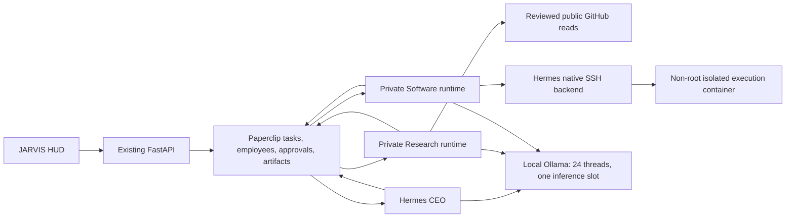

# Hermes runtime and evidence contract

Phase 12 extends the accepted staffing commit `e4c60d0`. Live runtime acceptance
passed on 2026-11-13. Its scope is scoped execution, real tool use, isolation,
native artifact delivery and evidence verification. Comparative research quality
and the complete CEO workflow remain Phase 14 acceptance work.

| Live check | Native task / successful run | Observed result |
| --- | --- | --- |
| Research | JAR-41 / `c5b33e5a-3c4f-45f7-b6fe-869cd445a900` | Three live primary-source reads; stored source snapshot and exact module inventory |
| Software | JAR-42 / `f6b5e6f7-8c3d-42a6-a5b5-0cf056d6db57` | Eight operator-fixture isolation checks, two program tests, three offline Promptfoo cases |

Native attachment authorship, originating run, bytes, hashes, issue sessions,
derived-key signatures and actual local-model traces were checked. An
independent operator reran the delivered Software files. Its output is recorded
separately from agent execution. The full regression suite passed 213 tests.
Protected AIGoat/PentAGI containers and all nine existing model definitions were
compared against the original snapshot and were unchanged.



Paperclip alone creates assignments, releases dependencies and wakes the CEO.
The operator runtime reconciler manages approved containers and readiness; it
never creates, assigns, retries or completes tasks. Test drivers explicitly
submit acceptance fixtures and do not run as application services.

Every employee has separate API credentials, Hermes home, session database and
tool configuration. Each issue uses the native `issue` gateway session key and
its own `/workspace/issues/<Paperclip issue UUID>` cwd. Memory learning is off.
Files are retained for history. Containers isolate employees; issue directories
and sessions isolate their ordinary task contexts within an employee's retained
workspace. A terminal is confined to that employee's container, while file and
artifact tools additionally enforce the current issue path.
Multi-file patch payloads and cross-profile overrides are rejected. File edits
use an explicit file path; the task directory itself cannot be overwritten.

The execution container has no Kali mount, Docker socket, API credentials,
published port, external route or DNS forwarding. It runs as UID 1000 with a
read-only root, private writable workspace/tmpfs, capability removal, PID and
CPU/memory limits. Only its owning trusted runtime shares its isolated SSH
network. The trusted Research parent has egress for a fixed public GitHub
catalog; model-facing tools cannot choose arbitrary URLs or execute a shell in
that parent. This is a tool allowlist, not a claim of domain-level firewalling.

The reviewed image pins Python 3.12, Node 22.22.0 and Promptfoo 0.125.1.
The current image is `jarvis-command-center:employee-sandbox-v3`; v1/v2 remain
available for historical verification and rollback. Build it from the repo root:

```sh
docker build -f deploy/Dockerfile.employee-sandbox -t jarvis-command-center:employee-sandbox-v3 .
```

The image includes the reviewed operator-authored
`/usr/local/share/jarvis/isolation_checks.py` fixture. An employee executes its
eight real isolation/resource checks using the ordinary Hermes terminal tool.
Its output is recorded as fixture execution, not employee-authored source.
Passing that fixture cannot replace tests of the employee's generated program.
Promptfoo demonstrations use offline echo providers and deterministic
assertions, `--no-cache --no-write --max-concurrency 1`, and native JSON
artifacts. Telemetry/update checks are disabled in SSH sessions. A toy fixture
demonstrates the evaluation harness; it is not a security efficacy benchmark.
Framework research alone never counts as executing a framework.
The runtime checks the actual JSON named by a successful recorded `promptfoo
eval --output` command and requires passing statistics with no failures/errors.
Help output or exit zero without a result file cannot satisfy this check. The
signed receipt carries the result-file hash, and CEO review requires matching
native artifact bytes. A reviewed echo configuration example is supplied as
reference context; it does not count as execution.

| Role | Model-accessible work |
| --- | --- |
| Research | Local model metadata, reviewed public sources, native report artifacts |
| Software Development | Private SSH terminal/file tools, completed sibling artifacts, native deliverables |
| System Administration | Bounded inventory/sandbox diagnostics; sensitive-action proposals |
| Documentation | Private file editing, reviewed sources, sibling artifacts, native reports |
| Security Analysis | Private analysis/testing, reviewed sources, sibling artifacts, sensitive-action proposals |

Only the existing Research worker and human-approved Software employee are
provisioned. Other roles remain templates. Internal delegation, cron, kanban,
browser, messaging, code-execution and skill-creation toolsets are disabled.
No MCP integration or additional orchestration service was introduced.

Sensitive operations use native `request_board_approval` records. The tool only
records a proposal and puts work into review. Approval does not unlock host or
external tools: an operator must separately review and perform the exact
authorized action. Hiring uses the native hire approval and frozen profile
snapshot; the CEO cannot approve itself or replace a rejected hire silently.

Version 3 execution receipts are created by actual admitted Hermes callbacks,
not by parsing assistant prose. They bind company, employee, issue, native run,
issue session, frozen capability/model, tool call IDs/results and native
attachment receipts. Each employee holds only a derived signing key. The CEO
verifies signatures using the company key, the latest succeeded assignee run,
native authorship and actual attachment byte hashes. Historical version 2
inventory receipts remain supported. `JARVIS_TOOL_EVENT` comments journal actual
progress in Paperclip. Model-authored summaries and generated artifact content
remain interpretation, even when their execution provenance is verified.

Actual final reports and files can be delivered by the runtime after successful
work/test checks. This is result storage, not a fabricated model tool call.
Receipts identify these deliveries separately. Reports receive an exact source
manifest from the retrieval data; invented or abbreviated digests are rejected.
Raw execution journals are kept out of model wake inputs. A short native
`payloadTemplate.input` delegates task context to the authenticated preflight,
which reads the real objective, scoped state and latest human instructions.
Full source snapshots remain in Paperclip while excerpts entering inference
are bounded. Progress comments contain a real newline so Paperclip's legacy
single-line escape normalization cannot corrupt embedded JSON.
Primary-source snapshots include observed repository component listings.
Research briefs must distinguish module names and documented capabilities from
inferred architecture. The first stored research draft had a factual error
despite valid provenance; its native issue was placed in review with an explicit
quality note. Provenance validation is not factual approval. The CEO can request
a concrete correction on the existing child, preserving its history and native
execution holds instead of creating a duplicate task.

For explicitly assigned source-module inventories, the runtime formats the
observed API fields into a report and labels that delivery as tool data. It
does not accept model-generated architectural conclusions as inventory data.
This formatter is not used to fulfill comparative-analysis objectives. Earlier
incorrect research drafts and failed Software attempts remain in native task
history and in the public failure/recovery receipts; they were not counted as
successful work.

New tasks explicitly request Paperclip's native
`workspaceSelection: {"kind": "task_directory"}`. The installed version can
otherwise infer a Git workspace for a retained directory and fail repair before
Hermes starts. Existing tasks use the native `PUT /issues/{id}/workspace`
selection API with a binding revision and request key; its pending selection
applies on the next normal admission. The project workspace policy was restored
to its original value after this compatibility test. This does not assert that
every legacy automatic-repair path is fixed.

The installed REST attachment projection names the execution field
`originatingRunId`. Legacy `createdByRunId` is normalized, and conflicting
identities fail closed. The first live test caught this mapping difference;
its blocked run and stored source snapshot were retained rather than accepted.

Run `python3 tests/live_sandbox.py --run --phase12` for the real isolated SSH
transport check. Opt-in role tests are `python3 tests/runtime_e2e.py --run --role
research` and `--role software_development`. Their ignored stage files resume
the same native task and submission ID; they do not silently create retries.
The sandbox test includes a separate operator-owned three-case offline echo
evaluation. Its evidence is explicitly labeled as an operator control and does
not substitute for an employee run.

For an approved runtime upgrade, first inspect native live/queued runs, then
run `python3 deploy/staffing.py --apply --refresh-idle-runtimes`. Add
`--agent-id <native employee UUID>` to reload a single idle employee. The command
defers busy employees, pauses idle employees natively, preserves their state,
reloads owned containers and resumes only after authenticated health and native
adapter checks pass. A failed upgrade remains paused. Inspect
`journalctl --user -u jarvis-employee-runtimes.service` and gateway logs.

For rollback, keep Paperclip state, workspace files, native artifacts and
evidence. Config backups are private under `.runtime/backups/phase12`; the
Phase 11 image is retained. Disable the runtime timer, wait for owned work to
finish, restore the desired source/config together, and recreate only owned
employee containers. Older CEO code only validates v2 receipts: restore the v3
validator before continuing a v3 objective. Do not replay completed tasks.

References: [native Hermes Gateway](https://docs.paperclip.ing/reference/adapters/hermes-gateway/),
[Hermes profiles](https://hermes-agent.nousresearch.com/docs/user-guide/profiles),
[Promptfoo echo provider](https://www.promptfoo.dev/docs/providers/echo/).
